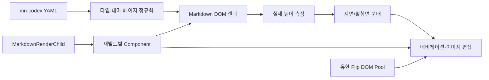

# 아키텍처

## 한 문장 요약

YAML 코드 블록을 불변의 입력으로 보고, Obsidian `Component`가 소유하는 렌더 수명주기 안에서 정규화 → Markdown 렌더링 → 실측 페이지 분할 → 상호작용 연결 순으로 DOM을 구성한다.

## 책임 경계

| 영역 | 역할 | 소유권 |
|---|---|---|
| 플러그인 | 명령·템플릿 카탈로그, 영속 이미지 배치 | `Plugin` |
| 코드 블록 | YAML 파싱, 오류 경계, 최상위 DOM | `MarkdownRenderChild` |
| 책 1회 빌드 | Markdown 자식, 이미지 오류 리스너, 페이지 제어 | 재빌드별 `Component` |
| 장 이동 애니메이션 | 무대 1개, 종이 최대 16개 | `BookFlipDomPool` |
| 문서 내용 | 현재 장의 타겟·이전 장 스냅샷 | 전환 1회, 종료 즉시 해제 |

## 렌더 수명주기

1. `MarkdownRenderChild`가 코드 블록 전체 수명을 소유한다.
2. book 모드는 각 빌드마다 자식 `Component`를 만든다.
3. 폭 변경으로 재페이징하기 전, 이전 자식을 unload해 Markdown 자식과 DOM 이벤트를 해제한다.
4. 새 DOM을 빌드하고 새 제어기를 `root._mnBookController`에 연결한다.
5. 코드 블록이 언로드되면 ResizeObserver, 제어 리스너, 활성 pointer 제스처, DOM 풀을 함께 정리한다.

## 페이지 분할

페이지 분할은 CSS 글자 수 추정이 아니라 렌더링된 DOM의 `scrollHeight`/`clientHeight`를 사용한다. 최상위 블록을 우선 이동하고, 긴 문단과 목록은 문장·어절·항목 경계에서만 분할한다. 단일 요소가 지면보다 큰 경우에는 데이터를 손실시키지 않고 해당 지면에 내부 스크롤을 허용한다.

## 성능 설계의 경계

- 원본 페이지 DOM은 사용자 내용이므로 풀링하지 않는다.
- 반복 생성하며 내용을 소유하지 않는 애니메이션 종이 DOM만 풀링한다.
- 자동 페이지 분할은 정확도를 위해 최초 1회 전체 렌더를 유지한다. 이는 로딩 시간과 읽기 정확도 사이의 의도한 선택이다.
